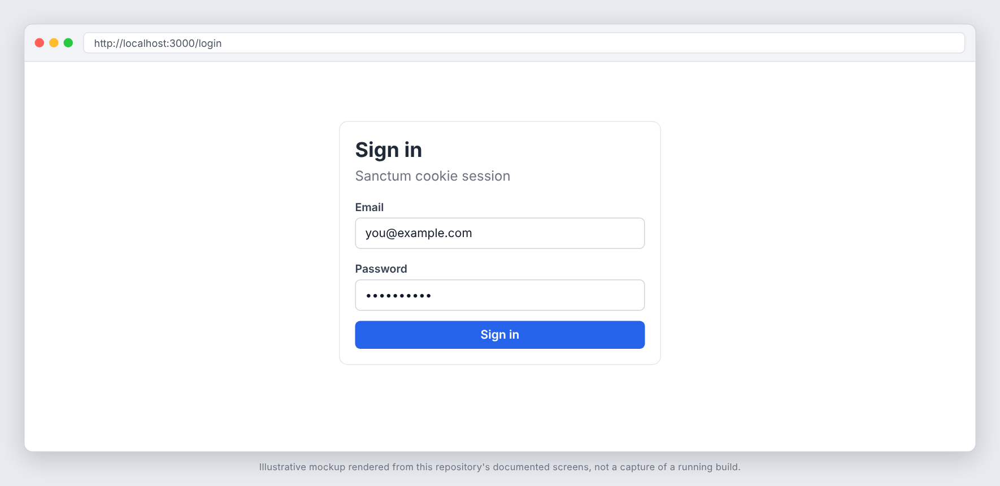
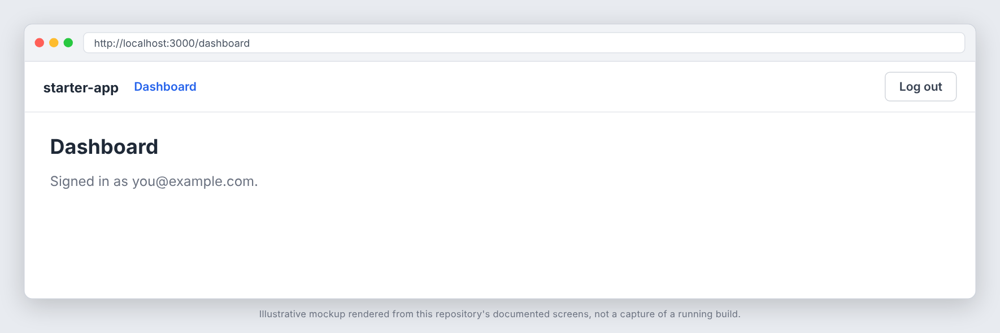

# starter-app

A starter template for a **Laravel 13 API** with a **Nuxt 4** frontend in one
repository: Sanctum cookie (SPA) authentication, a single error contract,
least-privilege Postgres roles, Pest + Larastan + Pint, Vitest + Playwright,
Docker Compose services and GitHub Actions CI with security scanning.

It carries no domain code. Everything here is infrastructure you would
otherwise rebuild on day one.

## Screenshots





_These images are illustrative mockups rendered from this repository's documented screens and API shapes, not captures of a running build. Regenerate or replace them with real captures once the app is running._

## What is in it

| Area | Contents |
|---|---|
| API core | `bootstrap/app.php`, `App\Exceptions\ApiExceptionRenderer` (the `{error, fields}` contract), `RespondsWithJson` (`ok()`, `error()`, `paginated()`, `perPage()`), `EnsureRole` middleware, login rate limiter, `AuthController` (login / me / logout), `GET /api/ready`, trusted-proxy support |
| Config | Sanctum SPA, explicit-origin CORS, Redis sessions, `rate_limiting.php`, two Postgres connections (`pgsql` runtime role, `pgsql_migrator` owner role) |
| Frontend (`frontend/`) | Nuxt 4, `useApi` (CSRF handling + typed errors), `useFormErrors`, `useSession`, `auth` route middleware, `error.vue`, the shared components below, ESLint, Vitest, Playwright, Dockerfile |
| Tests | Pest 5 (Feature, Unit), CSRF/login/rate-limit/error-contract tests, Vitest unit tests, Playwright specs against the real API |
| Tooling | Pint, Larastan (level 8 on `app` and `database`), `.editorconfig`, Docker Compose (Postgres, Redis, RabbitMQ), CI |
| Governance | MIT `LICENSE`, `SECURITY.md`, `CONTRIBUTING.md`, `CODE_OF_CONDUCT.md`, Dependabot, issue/PR templates, `osv-scanner.toml` (dated exceptions only) and an empty `.gitleaksignore`, `scaffold-memory-pack.sh`, empty `docs/project-memory` |

### Shared components (`frontend/app/components/`)

All are covered by `frontend/tests/unit/components.test.ts`.

| Component | Purpose |
|---|---|
| `AppButton` | Button with `primary` / `link` variants; `type` defaults to `button` |
| `AppTextInput` | Labelled `v-model` input with a field error (`:error="fieldError('email')"` from `useFormErrors`) |
| `FormField` | Label + error wrapper around any control, for selects and textareas |
| `AppAlert` | Error (`role="alert"`) or info (`role="status"`) banner |
| `AppSpinner` | Accessible loading indicator |
| `AppEmptyState` | Title, description and an actions slot |
| `AppModal` | Dialog with Escape / backdrop / close-button dismissal; parent owns `open` |
| `AppPagination` | Previous / next for a `PageMeta` (hidden for a single page) |
| `AppDataTable` | Columns + rows, `#cell-<key>` slots, spinner while loading, empty state |

`layouts/default.vue` is the app shell and `error.vue` the error page. A list
endpoint returns `$this->paginated($query->paginate($this->perPage($request)))`
on the backend, which is the `Paginated<T>` type in `app/types/api.ts` and what
`AppDataTable` + `AppPagination` consume.

### Optional modules (enabled by default)

Each module lives in clearly named folders and is wired in through one service
provider line in `bootstrap/providers.php`. Delete the paths below to remove it.

**Tenancy** (multi-tenancy with two enforcement layers: Eloquent global scopes
and Postgres row level security)

- Code: `app/Tenancy/`, `config/tenancy.php`, `routes/tenancy.php`,
  `database/migrations/tenancy/`, `database/factories/Tenancy/`
- Tests: `tests/Tenancy/`
- Also remove: the `TenancyServiceProvider` line in `bootstrap/providers.php`,
  the `Tenancy` testsuite in `phpunit.xml` (PHPUnit aborts on a missing suite
  directory), the `test:tenancy` composer script, and set
  `NUXT_PUBLIC_TENANCY=false` for the frontend.
- Includes `TenantContext` (GUC set via `set_config` inside a transaction),
  `BelongsToTenant`, `auth.tenant` / `auth.tenant.external` middleware,
  slug and signed-token tenant resolution, `TenantScopedJob`, an example
  tenant-scoped model (`Note`), and a manifest-driven isolation test suite that
  fails when a new tenant table ships without an RLS policy.

**RabbitMQ** (queue transport built directly on php-amqplib, with TTL +
dead-letter delayed delivery and retry tracking)

- Code: `app/Queue/RabbitMq/`, `routes/rabbitmq.php`
- Tests: `tests/RabbitMq/`, `tests/Support/RabbitMq/` (need a real broker; Pest
  group `queue-broker`)
- Also remove: its line in `bootstrap/providers.php`, the `RabbitMq` testsuite
  in `phpunit.xml`, the `test:queue-broker` composer script, the `rabbitmq`
  connection in `config/queue.php`, `rabbitmq_management` in
  `config/services.php`, the `RABBITMQ_*` env vars, the compose service and the
  CI service/step, then set `QUEUE_CONNECTION=redis`.

Both modules were verified removable: with every path above deleted, Pint,
Larastan and the remaining (non-module) tests still pass.

## Getting started

Requirements: PHP 8.4+, Composer, Node 22+, Docker (or local Postgres 16+,
Redis, and RabbitMQ if you keep that module).

```bash
# 1. Name your project (replaces the starter_app / starter-app placeholders)
./rename.sh my-project your-vendor

# 2. Services (creates the Postgres roles and both databases on first boot)
docker compose up -d

# 3. Backend
composer update            # generates composer.lock: commit it
cp .env.example .env
php artisan key:generate
php artisan migrate --database=pgsql_migrator
php artisan db:seed        # local only: admin@example.test / password
php artisan serve --host=localhost

# 4. Frontend (second terminal)
cd frontend && npm ci && npm run dev -- --host=localhost
```

Open <http://localhost:3000>. Use `localhost` for both servers, never
`127.0.0.1`: cookies are scoped by hostname.

No `composer.lock` is shipped (it must be generated on PHP 8.4+); CI falls back
to `composer update` until you commit one.

## Day-to-day commands

```bash
composer ci:check            # Pint + Larastan + fast tests (what CI gates on)
composer test:tenancy        # tenant-isolation suite only
composer test:queue-broker   # RabbitMQ module tests (needs a broker)
composer lint:fix            # apply Pint

cd frontend
npm run lint && npm run typecheck && npm run test:unit
npm run test:e2e             # Playwright: needs the seeded backend
```

## Conventions worth knowing

- **Error contract.** Every error under `api/*` is `{"error": "CODE"}`, plus
  `"fields": {...}` for `VALIDATION_FAILED` (422). Clients branch on the code.
  See `app/Exceptions/ApiExceptionRenderer.php` for the list. The Nuxt app's
  `apiErrorBody()` / `useFormErrors()` consume exactly this shape.
- **Auth.** Sanctum SPA mode: `GET /sanctum/csrf-cookie`, then echo the
  `XSRF-TOKEN` cookie as `X-XSRF-TOKEN` on state-changing requests (`useApi`
  does this). One shared `web` session guard; roles are checked by
  `role:admin` middleware.
- **Database roles.** The app connects as a non-owner role with no
  `BYPASSRLS`; migrations and seeders use `pgsql_migrator`. Never put the
  migrator credential in the runtime environment.
- **Tests use real Postgres, never SQLite.** RLS, uuid defaults and the role
  split have no SQLite equivalent.

## Project layout

```
app/                 Laravel application code (Tenancy/ and Queue/RabbitMq/ are modules)
config/              Framework + module config
database/            Migrations (migrations/tenancy/ is the module), factories, seeders
docker/postgres/     Role and database bootstrap SQL
frontend/            Nuxt 4 app (own package.json, tests, Dockerfile)
routes/              api.php + one route file per module
tests/               Feature, Unit, Tenancy, RabbitMq, Support
docs/project-memory/ Empty project-memory scaffold
```

## License

MIT. Replace the placeholders in [`LICENSE`](LICENSE) before publishing.
